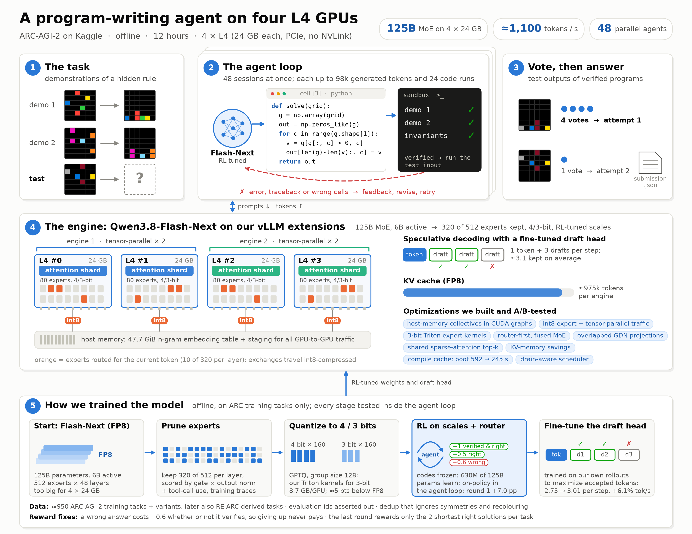
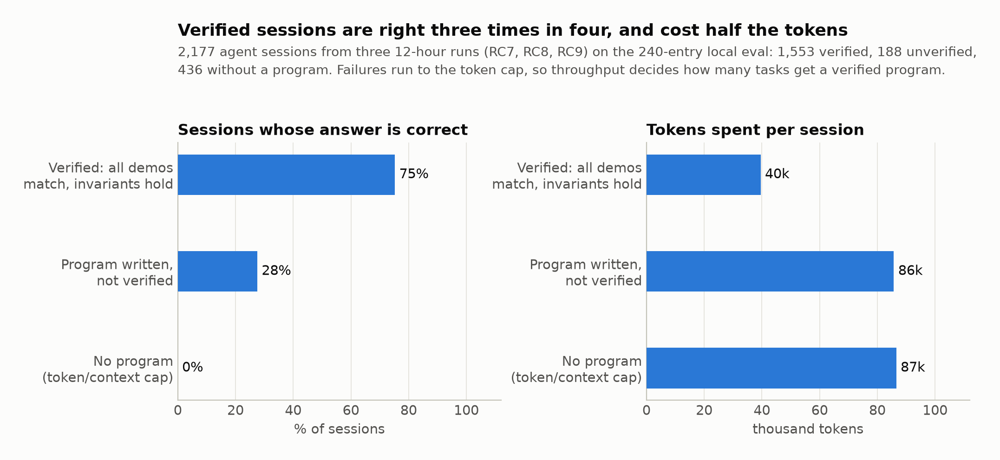
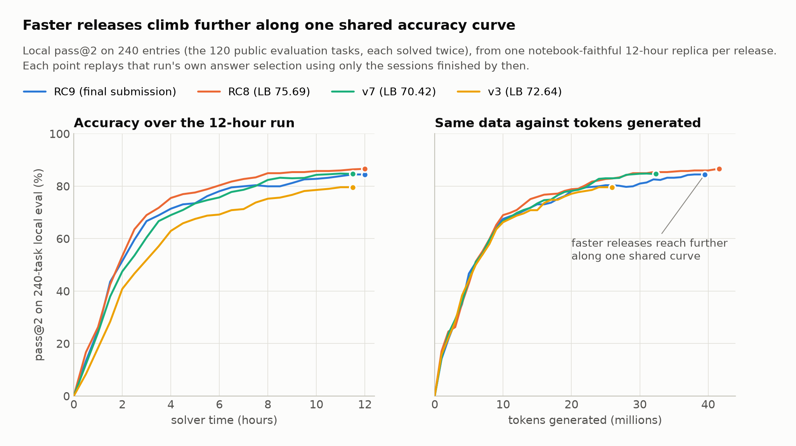
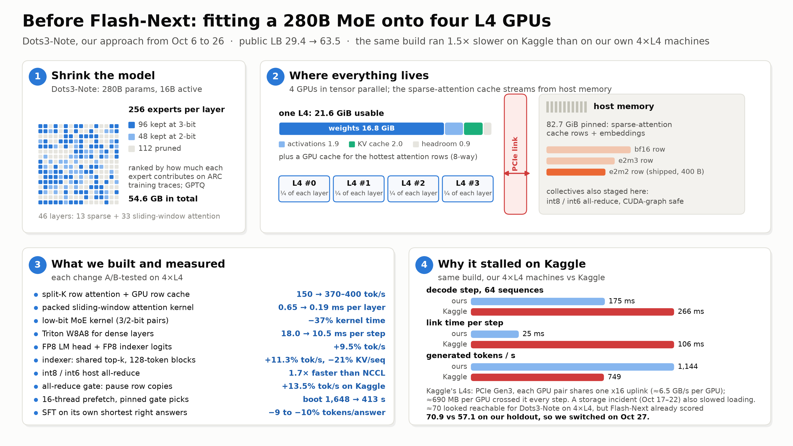
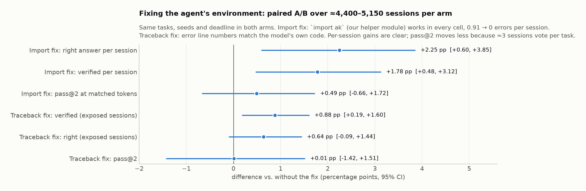
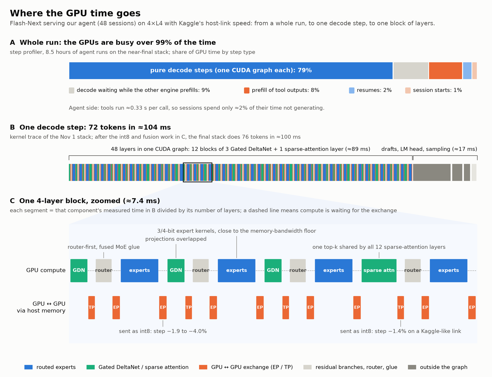
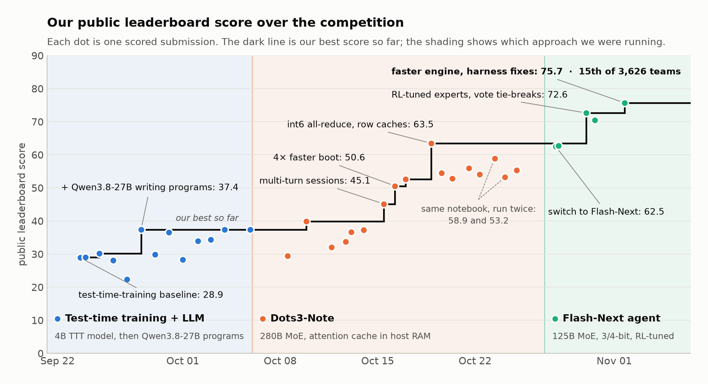

# Scaling Qwen 3.8 Flash-Next and Dots-3 Note to >1,100 tok/s on 4xL4

**Subtitle:** Qwen3.8-Flash-Next pruned and quantized to fit, repaired by RL in the agent loop, and served at >1,100 tok/s for 40M tokens per 12-hour run

*Public leaderboard: 75.69 with RC8, 15th of 3,626 teams at the close; the final bundle, RC9, is still being scored. The submission notebook, code, model parts and training code will be public soon. I relied heavily on agents for most of the work, including the writing of this writeup and the appendix, but still did a lot of steering and babysat most of what it wrote or decided.*

## Summary

On Kaggle's four L4 GPUs, with Qwen 3.8 Flash-Next, accuracy is a function of tokens:
- A program that reproduces every demonstration is usually right.
- A session that never finds one burns its whole budget.
- Replayed at equal tokens, our releases lie on nearly one accuracy curve.

So we treated the 12-hour limit as a token budget, and built:
- **an agent:** Qwen3.8-Flash-Next writes Python in a sandbox. A program counts only if it reproduces every demonstration and breaks none of 11 content invariants. Verified programs from about 3 sessions per task vote, with 48 sessions running at once.
- **a model that fits:** the 125B MoE, pruned to 320 of 512 experts per layer with a score that protects the tool-call format, and quantized to 4 and 3 bits. The damage is repaired by on-policy RL that trains only the quantization scales and the router (629M of 125B parameters) inside the agent loop: +7.0 pass@2 points [+3.8, +10.6].
- **a serving stack rebuilt for Kaggle's 4xL4s:** int8 host-memory collectives inside CUDA graphs, the model's 51B-parameter n-gram embedding in shared host memory, server-side sessions, and a draft head trained for expected accepted length. It reaches 1,087–1,120 tokens/s on Kaggle, where stock vLLM managed 140–310.

**Results.**
- Kaggle 2-hour checks rose from 110 to 122 to 134 of 240 as throughput rose from 1,021 to 1,087 to 1,120 tokens/s.
- 12-hour replicas score 84–87% locally.
- Public leaderboard: 75.69.

## 1. Why throughput is accuracy

**Failures set the cost.** We sorted 2,177 sessions from three 12-hour runs by outcome:
- The 1,553 verified sessions were right 75% of the time and stopped at 40k tokens on average.
- Sessions that ended with an unverified program were right 28% of the time; sessions with no program, never. Both kinds ran to the 98k cap.
- So the 29% of sessions that fail consume 47% of all tokens. Whether a hard task gets a verified program at all depends on the tokens left for it.

**Releases share one curve.** We replay each 12-hour run's own answer selection, using only the sessions finished by N tokens.
- Releases from 634 to 1,005 tokens/s then fall on nearly one concave curve. RC6 to RC8 are within 7 of 240 entries of each other; only the earliest, v3, trails, by 4–8.
- A release that looked +14.5 better locally had used 51% more tokens. At equal tokens it was +4.8, within noise.

**More tokens still pay.** With 79 sessions per task, pass@2 on the shipped model is 80.6 / 83.2 / 86.8 / 89.9% at 80 / 100 / 160 / 320k tokens per test input.

**The machine makes tokens expensive.**
- Kaggle's L4s sit in a virtual machine on PCIe Gen3, in two pairs that each share one x16 uplink.
- Peer-to-peer traffic goes through the host at 0.8–4.6 GB/s. With all four GPUs busy, each gets about 6.6 GB/s to host memory.
- Every extra 100 tokens/s buys each test input about 12k more tokens over a run.

## 2. Choosing the model

On Oct 27 we compared candidates at equal tokens per input on 40 held-out public evaluation tasks, replaying 572 sampled sessions under a global budget:

| Approach | pass@2 at 100k tokens/input |
|---|---|
| **Flash-Next as a REPL agent** | **70.9** |
| Dots3-Note answering directly (our model at the time) | 57.1 |
| Flash-Next answering directly | 45.9 |

**The switch.** On all 120 public evaluation tasks, the agent matched Dots3-Note's 100k-token score with about 45k tokens, and solved 43–49% of the inputs Dots3-Note never solved.

**Rejected on measurements:**
- **Pruned DeepSeek-V4.1-Flash.** 77–82 unpruned, but every version that fits lost 7–19 points, and streaming experts over PCIe costs about 0.3 s per step.
- **Qwen3.8-27B as a REPL agent.** 33.75 on the 40 tasks; on 4×L4 its decode collapsed from 725 to 129 tokens/s as contexts grew.
- **Dots3-Note as a tool agent.** −5.76 of 240 against its own direct mode.

## 3. Before Flash-Next: Dots3-Note on 4×L4

From Oct 6 to 26 we ran Dots3-Note, a 280B MoE (16B active) with sparse plus sliding-window attention, on the same four GPUs.

**How it fit.**
- We kept 144 of 256 experts per layer at 3 and 2 bits (54.6 GB), tensor-parallel across all four GPUs.
- The 82.7 GiB sparse-attention cache lived in pinned host memory and streamed back every step. Split-K attention, a GPU cache for hot rows and compact 400-byte rows made that workable.

**How it got faster.**
- Host all-reduce in int8/int6 ran 1.7× faster than NCCL.
- Server boot went from 1,648 s to 413 s.
- Multi-turn sessions, the faster boot and cheaper collectives took our score from 37 to 63.47.

**What held it back: the machine.** The same build ran at 749 tokens/s on Kaggle, against 1,144 on our own machines. It moved about 690 MB per GPU across the shared PCIe uplinks every step: 106 ms on Kaggle against 25 ms.

**What carried over to Flash-Next.**
- Its host collectives, server-side sessions, low-bit kernels, deadline handling and evaluation practice.
- Two warnings: distillation toward the full-precision model hurt both models, and the best sampling temperature was model-specific (0.7 for Dots3-Note, 1.0 for Flash-Next).

## 4. Making the model fit, then repairing it

### Pruning

All 512 experts at 4 bits take 18.9 GiB per GPU, leaving no room for KV cache.

**Agents fail on format first.**
- Pruning by routing mass kept 89% of it at 256 experts. Yet a fifth of tool calls then lost their `<parameter=code>` header, and sessions verified 0.34 of the time instead of 0.78.
- The experts that route rare format tokens carry little total mass, so a usage ranking drops them.
- Adding tool-call and tool-response routing mass to the score fixed it.

**Compression must be measured in the agent loop.** In direct-answer mode, compressed builds were indistinguishable from FP8. In REPL mode, the same builds lost 5–12 points.

### The shipped build

- **Selection.** It keeps 320 of 512 experts in every layer, scored by a REAP-style saliency (gate × output norm) plus tool-call routing mass, on the model's own traces of ARC *training* tasks.
- **Quantization.** GPTQ puts the 160 most-routed experts per layer at 4 bits and the rest at 3 bits: 8.7 GB of experts per GPU. vLLM's Marlin kernel and our Triton kernel run the two groups concurrently.
- **Cost.**
  - About 6 REPL points against FP8.
  - It shows as less precise verified programs (0.73 vs 0.82), not as fewer of them.
  - Pruning alone and quantization alone each cost 5–6.6 points, so the damage does not add.

Details are in Appendix A.

**Distillation does not repair it.** KL distillation toward the FP8 model removed 36% of the excess KL, yet lost 3.9–4.5 REPL points: the student committed to programs earlier. Lower KL is not more solved tasks, so we optimized the solve rate directly.

### RL on the quantization scales

**What learns.**
- The integer codes are frozen. We learn a log-offset per quantization group (589.8M parameters) and the kept router rows (39.3M).
- Kernels, memory and files are unchanged; the result ships as a 1.3 GB delta.

**How.**
- Gradients reach the scales through a PyTorch re-implementation of the model. A custom autograd function rebuilds each weight from its packed codes on the fly, so one full model trains on one H200.
- Rollouts come from the shipped harness itself.
- The update is REINFORCE with a leave-one-out baseline (Appendix B).

**Two lessons.**
- **Reward holes become behaviour.** Our first reward made a wrong answer cheaper when it was unverified, and the policy learned to give up: the verified rate fell from 0.814 to 0.772. Charging −0.6 for any wrong answer fixed it.
- **The first round does the work.** It added +7.0 pass@2 points [+3.8, +10.6] on the 120 public evaluation tasks, with 12% shorter sessions.
  - Two later shipped rounds (a budget-aware reward, then credit only for the 2 shortest right answers per task) tied at 79 sessions per task.
  - Ten other variants failed: precision rose while sessions grew about 10% longer per round.

RL also tripled how often sessions write `import ak`, which exposed a harness bug (section 5).

### The draft head

The MTP layer drafts 3 tokens per step.
- We fine-tuned it on the RL model's own rollouts to maximize the expected accepted length (Appendix C): 2.75 → 3.01 tokens per step on 4×L4, +6.1% tokens/s.
- An int8 copy limited to the 32,768 most-used tokens made sampled drafting pay off: +19% tokens/s.

## 5. The agent

**The loop.**
- Each session gets the task as digit grids, an API sheet for our helper library `ak`, and one tool, `python`.
- Every call runs in a fresh sandboxed process. If it defines `transform`, the harness runs it on every example and returns a masked diff.
- A session ends at its first verified program, after 24 calls or after 98,304 tokens; otherwise it gives a final answer.

**Verification is the precision filter.**
- A program is verified when it reproduces every training output, returns valid test grids, and breaks none of 11 invariants that hold on all of the task's training pairs (palette subsets, output ≠ input, colour counts that never rise or fall, and so on).
- A program that breaks an invariant is told so, and the session continues.
- `ak` provides objects, symmetries, periodicity, size rules, diffs and the invariants. In a pre-registered A/B it gave +2.6 [+0.2, +5.2] at 100k tokens per input, with verified precision 0.82 against 0.72.

**Align the environment with the model's habits.** Two bugs were invisible to our offline evaluation pools, which never ran that code path:
- **Import fix.** A failing `import ak` was re-prepended into later cells: 0.91 errors per session. Aliasing the module added +2.25 points of right answers per session [+0.60, +3.85] over about 4,400 sessions per arm.
- **Traceback fix.** About 30% of tracebacks pointed at the wrong line. Fixing them added +0.88 points of verification on the sessions affected.

**What did not help.** A hand-read failure atlas split the lost points:
- 38%: only wrong programs verified;
- 22%: nothing verified;
- 18%: a right program was outvoted;
- 21%: budget.

Review turns, requests for alternative programs and generalization prompts were all negative in within-sample tests. Aborting slow sessions early cost 3–18 points (Appendix D).

## 6. Spending twelve hours

**Scheduling.**
- Every task first gets one session; more follow while budget remains, each to the task with the fewest so far.
- A task whose top answers have at least 2 votes and a lead goes to the back of the queue: +0.8.
- A new session on a task with nothing verified starts with an earlier session's best unverified program and its per-example results: +0.21 right answers per session, with 17% fewer tokens.

**Admission and budgets.**
- Throughput grows almost linearly with running sequences (tokens/s ∝ running^0.95), so the KV cache sets the batch.
- A session starts only if fewer than 48 are running and the projected contexts of all sessions fit. That keeps about 14% of KV in reserve; using it through KV-aware routing lost 2.2% tokens per hour.
- Sessions may generate 98,304 tokens. A cap raise worth +1.9 to +3.1 on the FP8 model gave only +0.9 on the shipped one, so we validate every lever on the shipped build.
- Near the deadline, a drain lets running sessions finish and answer: +1–3% tokens.

**Answers.**
- Each session casts one vote per test input from its verified program.
- Ties go to programs that keep the training pairs' symmetries on the test inputs and have no code that runs only on a test input. Programs failing these checks are right only 36% and 50% of the time, against 70% overall: +0.54 [+0.28, +0.84].
- attempt_2 is the most common other grid any program produced.

**Selection is nearly saturated.** A perfect pick among the produced candidates would add only +0.8, and a learned scorer added +0.74. The remaining points are in producing right programs, not in picking them (Appendix E).

## 7. The engine

Our vLLM 0.32 plugin runs two data-parallel engines of 24 sequences each, each tensor-parallel over 2 GPUs, with the experts spread across all four (Appendix F).

- **Collectives without peer-to-peer.**
  - Every exchange goes through pinned host memory, driven from the GPU and captured inside the CUDA graph: a one-kernel all-reduce over a registered shared-memory buffer, and host-staged all-gathers and reduce-scatters.
  - An all-gather plus reduce-scatter takes 52–271 µs, against 114–347 µs with NCCL: +8.6% tokens/s.
- **Fewer bytes.**
  - Both exchanges run at the host link's limit, so expert dispatch and the reduce-scatters travel as int8 with per-group scales.
  - That cut 1.9–4.0% off each step for expert traffic and 0.8–1.4% for tensor-parallel traffic, with teacher-forced KL at the run-to-run floor.
- **Memory is throughput.** The 47.7 GiB n-gram embedding lives once in shared host memory, gathered with zero copies. FP8 KV and dense projections, packed recurrent state and a shared top-k buffer raised the KV cache from 879k to 974k tokens per engine.
- **Recurrent state under speculative decoding.** Rejected drafts must be undone in the Gated DeltaNet layers. Folding accepted tokens into one BF16 checkpoint, instead of keeping a copy per draft position, allowed 49% more concurrent sequences.
- **Server-side sessions.** Keeping each session's cache on the server and appending only the tool output cut prompt processing from 6.1 to 0.2 tokens per generated token.

**Where the time goes now.**
- The GPUs are busy over 99% of the time, 79% of it in pure decode steps.
- About a third of a step is expert GEMMs near the memory-bandwidth floor; about a fifth is exchanges at the link floor.

**How we certified changes.** Greedy decoding is not reproducible on this stack, so every change passed bit-exact tests and a teacher-forced KL gate before a same-node A/B. Every flag logs that it is active, since one +8% "win" turned out to be a collective that never engaged.

## 8. How we evaluated

- **Local set.** The 120 public evaluation tasks, each included twice and solved independently: 240 entries. The disagreement between the two copies measures sampling noise; it explained about a third of each run's lost points.
- **Two scales.**
  - Offline pools of 4–79 sessions per task, with the solver's selection replayed under a budget: ±3.5 points at ×8, ±0.8 at ×79.
  - Notebook-faithful 12-hour replicas on our own 4×L4 test machines, with Kaggle's image, its memory limit and an emulated host link. Pairs of replicas differ by about 2.8 points.
- **Rules we learned the hard way.**
  - Use controls sampled at the same time: day-old pools drifted +3.3.
  - Require the same sign on both halves of the set: holdout gains reversed four times.
  - Fix thresholds before the run.
  - Compare at equal tokens.
  - Validate on the shipped build, in the real environment.
- **Local vs leaderboard.**

  | Release | Local | Leaderboard |
  |---|---|---|
  | v3 | 79.6% | 72.64 |
  | v7 | 84.7% | 70.42 |
  | RC8 | 86.6% | 75.69 |

  All 120 tasks were used for selection, so local scores are optimistic. We trusted throughput and Kaggle's own 2-hour checks over single-submission differences.

## 9. Leaderboard history

We ran three approaches:
- a test-time-training baseline with an LLM hybrid: about 37;
- Dots3-Note: 63.47;
- the Flash-Next agent: 75.69.

Within each, the big jumps came from more useful tokens per hour more than from prompt changes: multi-turn sessions, a 4× faster boot, cheaper collectives, RL-tuned experts, a faster engine.

## 10. What transfers, and where the remaining points are

- **Beyond ARC.**
  - Verify-then-vote synthesis applies wherever examples can check a candidate.
  - Format-aware pruning and in-loop evaluation apply to any MoE used as an agent.
  - Scale-only RL adapts any quantized model to its own harness without new kernels.
  - The engine serves any MoE on PCIe-only GPUs.
- **More tokens.** Tokens still pay (section 1), and some session answers 97.9% of inputs right. Failing sessions use 47% of tokens, but naive early abort costs points, so a learned stopping rule is the obvious next step.
- **Fewer wrong verifications.** Verified-but-wrong programs cause 38% of lost points, mostly when a test input has a feature the training pairs lack. Checking programs on synthesized inputs that resemble the test inputs is next.

## Reproduction

*Will be public soon.*

## Credits and references

- **Claude** as my most reliable companion for analysis and implementation.
- **Models.** The Qwen team, for Qwen3.8-Flash-Next; and Dots Studio, for Dots3-Note.
- **Prompt and feedback format.** These started from Adarsh's notebook [arc-qwen-3-8-27b-agent](https://www.kaggle.com/code/madarshbb/arc-qwen-3-8-27b-agent), which was modelled on Tufa Labs' [Duck harness](https://github.com/Tufalabs/duck-harness).
- **Software.** vLLM, FlashInfer, Triton and flash-linear-attention.
- **Methods.**
  - Compression: GPTQ (Frantar et al., 2022); REAP (Lasby et al., 2025); Marlin.
  - RL and data: REINFORCE leave-one-out (Ahmadian et al., 2024); RE-ARC (Hodel, 2024).
  - Program synthesis: Greenblatt (2024); Poetiq; SOAR (arXiv 2507.14172).
  - Test-time approaches: test-time training (arXiv 2411.07279); NVARC (github.com/1ytic/NVARC); Product of Experts (arXiv 2505.07859).
  - ARC: ARC-AGI-2 (arXiv 2505.11831); the ARC Prize 2024 and 2025 reports (arXiv 2412.04604, 2601.10904).

## Appendix

Since this writeup is long enough, I have attached `solution_writeup_appendix.pdf` as a separate file, covering compression (Appendix A), reinforcement learning on the quantization scales (B), the draft head (C), the agent harness (D), scheduling, the deadline and answer selection (E), and the serving engine (F).
